  

  
  
  
  

<table>
<tr>
<td width="52%" valign="middle">

### Hey, I'm Debanshu 👋

I build **fast backends, real-time products, and AI systems** — from C++ memory management to distributed job queues and stateful agents.

🚀 **Incoming Summer Intern @ eBay · 2027**

💻 **SDE Intern @ Edumorph** · Aug 2026–present

🎓 **IIT Kharagpur** · Chemical Engineering 
&nbsp;&nbsp;&nbsp;&nbsp;&nbsp;2023–2028 · **9.25 / 10 CGPA**

My favorite engineering problems: concurrency, low latency, resilient infrastructure, and making complex systems feel simple.

</td>
<td width="48%" valign="middle">
  
</td>
</tr>
</table>

  

## 01 / Engineering in the real world

**Edumorph · SDE Intern** 
Aug 2026–present · Remote

- Built a video-progress pipeline with **Redis Cluster**, dirty-flag tracking, TTL jitter, and **BullMQ** workers for deferred database persistence.
- Engineered a **Razorpay** workflow handling **250+ transactions**, with dynamic QR codes, payment links, and automated checkout reminders.
- Built a notification scheduler reaching **2,000+ users** through **FCM**, with rich media and deep links.
- Integrated authentication and analytics as install-to-signup conversion rose from **55% to 78%**; built the Flutter frontend for a voice-enabled AI tutor.

**Webyalaya · Full Stack Developer Intern** 
Nov 2025–Feb 2026

- Built an async **AWS ECS / NestJS / Redis / BullMQ** pipeline that cut core API response time from **1,200 ms to 700 ms**.
- Added **Prometheus, Grafana, and Sentry** observability, idempotent payments, and Google Calendar synchronization.
- Reduced redundant transcription network calls by **60%** through React-side stream debouncing.

## 02 / Things I've built

### ⚡ [InMemoryDB](https://github.com/DEEN-42/MemoryAllocator)

**A C++17 in-memory key-value store built around concurrency and predictable latency.**

Non-blocking Winsock2 reactor, SPMC worker pool, 64-way sharding, memory arenas, a dual-buffered AOF logger, and an O(1) timing wheel. Includes a sharded token-bucket rate limiter and proactive memory eviction.

| Peak throughput | Latency | Stress test |
| :--- | :--- | :--- |
| **28,000 requests/s** | **0.4 ms p50 · 1.2 ms p99** | **1M requests · 1,000 clients · zero errors** |

Measured in project benchmarks; results depend on hardware and workload.

`C++17` `Winsock2` `Concurrency` `Memory management` `Persistence`

<table>
<tr>
<td width="50%" valign="top">

### 🧠 AI Interviewer

A stateful interview agent with adaptive Socratic questioning, continuous candidate scoring, and retrieval-augmented context.

**40% lower cost** · **sub-50 ms session recovery**

Three-model fallback routing maintained **90% uptime during API service outages** in project evaluation.

`LangGraph` `FastAPI` `Redis` `FAISS` `Tavily`

[Explore the code →](https://github.com/DEEN-42/AgenticAI_Interviewer)

</td>
<td width="50%" valign="top">

### 📝 Collaborative CV Builder

Conflict-free editing with Yjs CRDTs, binary state-vector deltas, and Redis Pub/Sub for cross-server synchronization.

**90% smaller payloads** · **96% fewer synchronous DB writes**

BullMQ write-behind persistence keeps database work off the live editing path.

`Yjs` `WebSockets` `Redis` `BullMQ`

[Explore the code →](https://github.com/DEEN-42/resumebuilder)

</td>
</tr>
<tr>
<td width="50%" valign="top">

### 🌾 FieldSync

**Smart India Hackathon 2025 finalist · Top 5 / 500+**

A six-service crop-residue logistics platform with spatial clustering, route optimization, and live machinery telemetry.

`Node.js` `PostgreSQL` `Redis` `OR-Tools` `Python`

[Explore the code →](https://github.com/DEEN-42/SIH25-FieldSync)

</td>
<td width="50%" valign="top">

### 🔐 OTP Validator

**Published open-source npm package**

A stateless time-based one-time password validation utility for developers integrating TOTP authentication.

`TypeScript` `npm` `TOTP`

[Explore the code →](https://github.com/DEEN-42/otp-validator) · [View on npm ↗](https://www.npmjs.com/package/otp-validator-totp)

</td>
</tr>
</table>

## 03 / Problem solving, competitively

| Platform | Handle | Peak rating | Achievement |
| :--- | :--- | ---: | :--- |
| **LeetCode** | [deen42](https://leetcode.com/deen42) | **2353** | Guardian · top **0.41%** at peak |
| **Codeforces** | [deen42](https://codeforces.com/profile/deen42) | **1736** | Expert |
| **CodeChef** | [debanshu_42](https://www.codechef.com/users/debanshu_42) | **1900** | 4-star |

## 04 / My engineering toolkit

| Layer | Technologies |
| :--- | :--- |
| **Languages** | C · C++ · JavaScript · TypeScript · Python |
| **Backend & APIs** | Node.js · NestJS · Express · FastAPI · WebSockets |
| **Data & queues** | PostgreSQL · Redis · MongoDB · MySQL · NeonDB · Prisma · BullMQ |
| **AI & retrieval** | LangGraph · LangChain · FAISS · Tavily |
| **Frontend & mobile** | React · Next.js · Tailwind CSS · Flutter |
| **Cloud & observability** | AWS · Docker · Git · Prometheus · Grafana · Sentry |
| **Foundations** | Data structures & algorithms · OOP · DBMS · Operating systems · Networks |

 

  <b>Have an interesting systems problem? Let's build.</b>  
  <a href="https://debanshu.me">debanshu.me</a> &nbsp; / &nbsp;
  <a href="mailto:debanshughosh685@gmail.com">Say hello</a> &nbsp; / &nbsp;
  <a href="https://www.linkedin.com/in/debanshu-ghosh-381962306">LinkedIn</a>

  

