  

  
  
  
  

<table>
<tr>
<td width="50%" valign="middle">

###  Hey, I'm Debanshu

I build **fast backends, real-time products and AI systems**, from C++ memory management to distributed job queues and stateful agents.

 **Incoming Summer Intern @ eBay** · 2027

 **SDE Intern @ Edumorph** · Aug 2026–present

 **IIT Kharagpur** · Chemical Engineering · **9.25** CGPA

Favourite problems: concurrency, low latency, resilient infrastructure.

</td>
<td width="50%" valign="middle">
  
</td>
</tr>
</table>

  

##  01 / Experience

  

##  02 / Things I've built

###  [InMemoryDB](https://github.com/DEEN-42/MemoryAllocator)

A C++17 in-memory key-value store built for concurrency and predictable latency: non-blocking reactor, 64-way sharding, memory arenas, AOF persistence and an O(1) timing wheel.

| Peak throughput | Latency | Stress test |
| :--- | :--- | :--- |
| **28,000 req/s** | **0.4 ms p50 · 1.2 ms p99** | **1M requests · 1,000 clients · 0 errors** |

`C++17` `Winsock2` `Concurrency` `Memory management` `Persistence`

<table>
<tr>
<td width="50%" valign="top">

###  AI Interviewer

Stateful interview agent with adaptive Socratic questioning and RAG context.

**40%** lower cost · **sub-50 ms** session recovery · **90%** uptime through API outages

`LangGraph` `FastAPI` `Redis` `FAISS` `Tavily`

[Explore the code →](https://github.com/DEEN-42/AgenticAI_Interviewer)

</td>
<td width="50%" valign="top">

###  Collaborative CV Builder

Conflict-free editing with Yjs CRDTs and Redis Pub/Sub across servers.

**90%** smaller payloads · **96%** fewer synchronous DB writes

`Yjs` `WebSockets` `Redis` `BullMQ`

[Explore the code →](https://github.com/DEEN-42/resumebuilder)

</td>
</tr>
<tr>
<td width="50%" valign="top">

###  FieldSync

**Smart India Hackathon 2025 · Top 5 / 500+**

Six-service crop-residue logistics platform: spatial clustering, route optimisation, live telemetry.

`Node.js` `PostgreSQL` `Redis` `OR-Tools` `Python`

[Explore the code →](https://github.com/DEEN-42/SIH25-FieldSync)

</td>
<td width="50%" valign="top">

###  OTP Validator

**Published npm package**

Stateless TOTP validation utility for developers adding one-time-password auth.

`TypeScript` `npm` `TOTP`

[Explore the code →](https://github.com/DEEN-42/otp-validator) · [npm ↗](https://www.npmjs.com/package/otp-validator-totp)

</td>
</tr>
</table>

##  03 / Competitive programming

| Platform | Handle | Peak rating | Title |
| :--- | :--- | ---: | :--- |
| **LeetCode** | [deen42](https://leetcode.com/deen42) | **2353** | Guardian · top **0.41%** |
| **Codeforces** | [deen42](https://codeforces.com/profile/deen42) | **1736** | Expert |
| **CodeChef** | [debanshu_42](https://www.codechef.com/users/debanshu_42) | **1900** | 4-star |

##  04 / Toolkit

| Layer | Technologies |
| :--- | :--- |
| **Languages** | C · C++ · JavaScript · TypeScript · Python |
| **Backend & APIs** | Node.js · NestJS · Express · FastAPI · WebSockets |
| **Data & queues** | PostgreSQL · Redis · MongoDB · MySQL · NeonDB · Prisma · BullMQ |
| **AI & retrieval** | LangGraph · LangChain · FAISS · Tavily |
| **Frontend & mobile** | React · Next.js · Tailwind CSS · Flutter |
| **Cloud & observability** | AWS · Docker · Prometheus · Grafana · Sentry |

 

  

  <a href="https://debanshu.me">debanshu.me</a> &nbsp;·&nbsp;
  <a href="mailto:debanshughosh685@gmail.com">Say hello</a> &nbsp;·&nbsp;
  <a href="https://www.linkedin.com/in/debanshu-ghosh-381962306">LinkedIn</a>

