

  

  
  
  
  

<table>
<tr>
<td width="50%" valign="middle">

###  Hey, I'm Debanshu

I build **fast backends, real-time products and AI systems**, from C++ memory management to distributed job queues and stateful agents.

 **Incoming Summer Intern @ eBay** · 2027

 **SDE Intern @ Edumorph** · Aug 2026–present

 **IIT Kharagpur** · Chemical Engineering · **9.25** CGPA

Favourite problems: concurrency, low latency, resilient infrastructure.

</td>
<td width="50%" valign="middle">
  
</td>
</tr>
</table>

  

##  01 / Experience

Click a role to expand it.


 

 

 

##  02 / Things I've built

Click a project to expand it.


 


 


 


 

##  03 / On GitHub

  <a href="https://github.com/DEEN-42"></a>

##  04 / Competitive programming

  <a href="https://leetcode.com/deen42"></a>
  <a href="https://codeforces.com/profile/deen42"></a>
  <a href="https://www.codechef.com/users/debanshu_42"></a>

 

  

  

  
  
  
  

