  

  
  
  
  

<table>
<tr>
<td width="50%" valign="middle">

###  Hey, I'm Debanshu

I build **fast backends, real-time products and AI systems**, from C++ memory management to distributed job queues and stateful agents.

 **Incoming Summer Intern @ eBay** · 2027

 **SDE Intern @ Edumorph** · Aug 2026–present

 **IIT Kharagpur** · Chemical Engineering · **9.25** CGPA

Favourite problems: concurrency, low latency, resilient infrastructure.

</td>
<td width="50%" valign="middle">
  
</td>
</tr>
</table>

  

##  01 / Experience

  

##  02 / Things I've built

  
  

  
  

##  03 / On GitHub

  

##  04 / Competitive programming

  
  
  

 

  

  

  <a href="https://debanshu.me">debanshu.me</a> &nbsp;·&nbsp;
  <a href="mailto:debanshughosh685@gmail.com">Say hello</a> &nbsp;·&nbsp;
  <a href="https://www.linkedin.com/in/debanshu-ghosh-381962306">LinkedIn</a>

